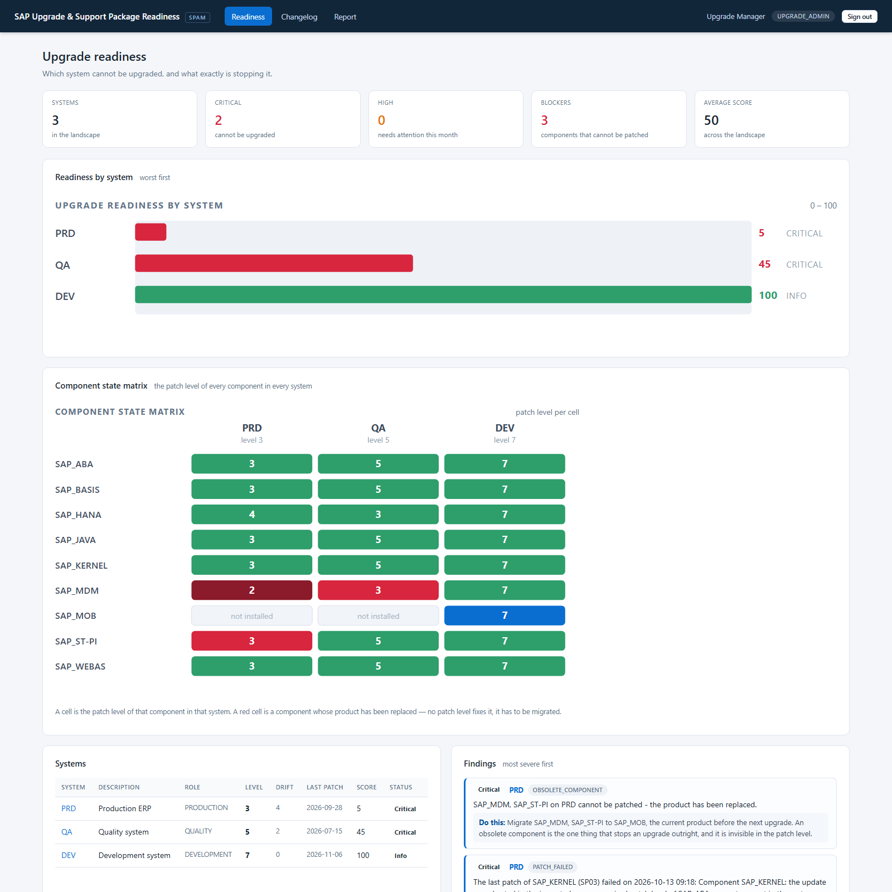
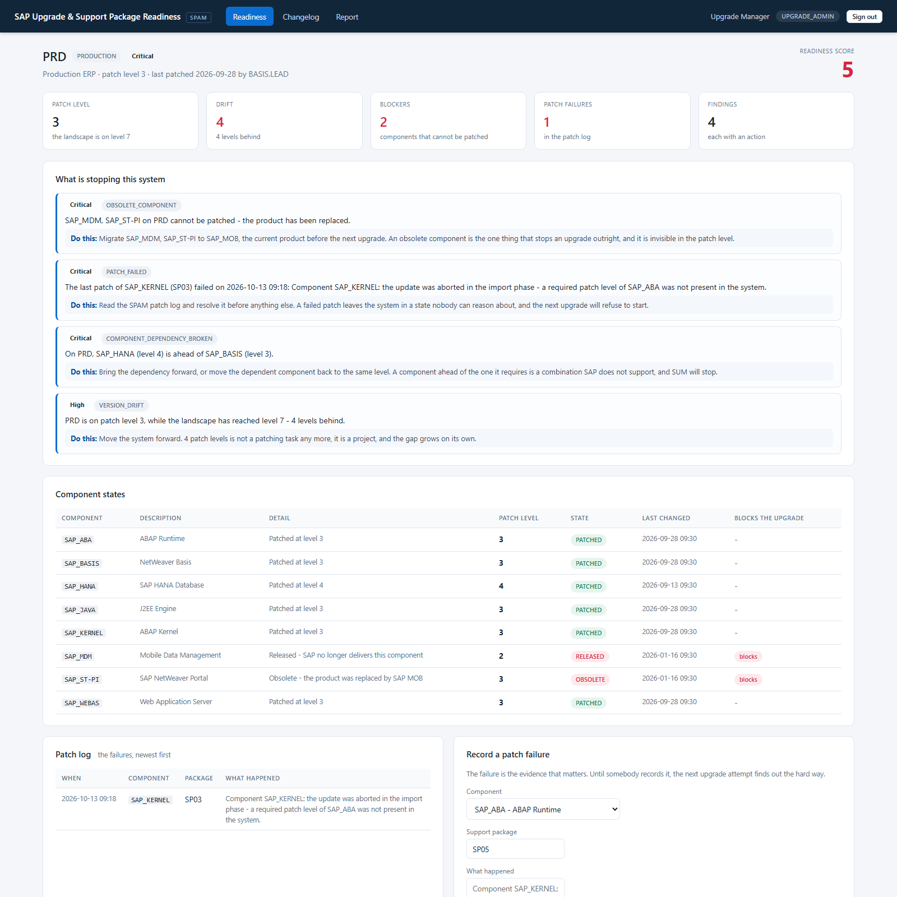
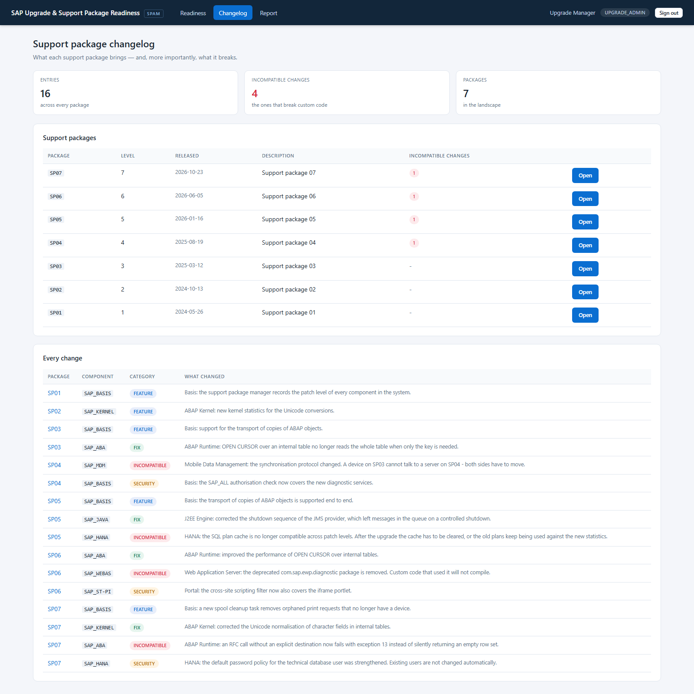
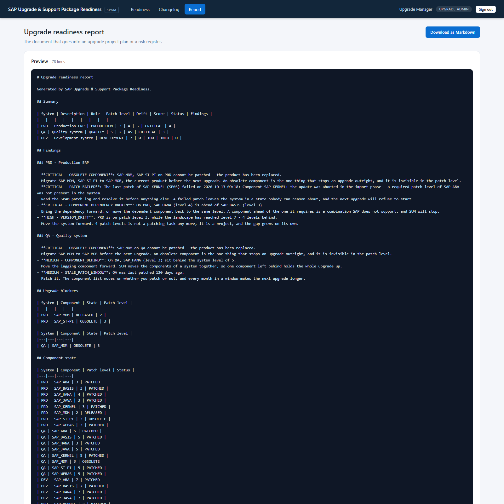
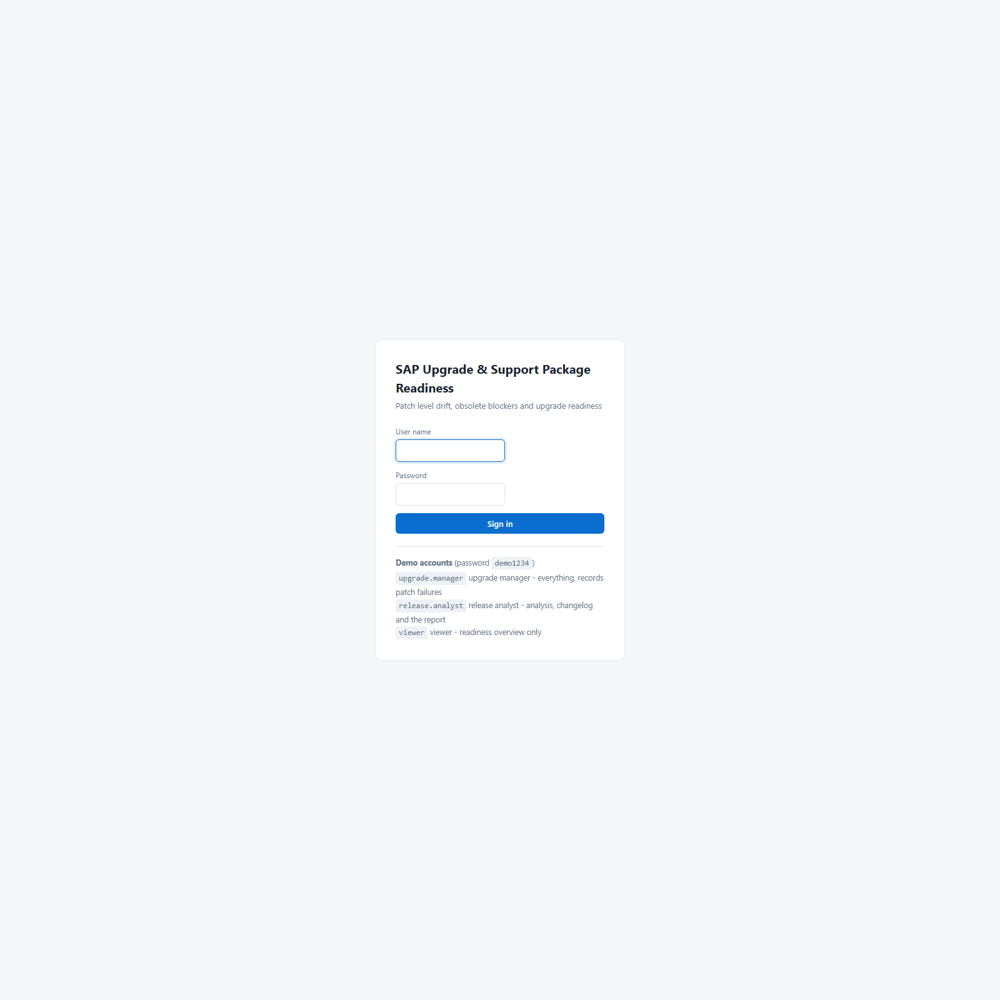

<div align="center">

# SAP Upgrade &amp; Support Package Readiness

**Upgrade readiness for SAP landscapes — obsolete component blockers, patch level drift, dependency checks, failed patch detection and a per-system readiness score**


</div>

---

## The problem

*"Which systems can we actually upgrade?"*

An upgrade project starts with a support package list and a maintenance
window, and then discovers that one system has a component whose product was
**replaced two years ago** — so no patch level fixes it, it has to be
*migrated* first. And that another system is four patch levels behind, which
is not a patching task any more, it is a project. And that a patch failed in
the night and nobody wrote it down, so the system is in a state nobody can
reason about.

None of that is visible in the patch level. The patch level is a number, and
a number hides everything that matters.

This analyzer answers the question the patch level cannot:

1. **Can this system be upgraded at all?** — a component whose product has
   been replaced has to be migrated first. Nothing else matters until that is
   done.
2. **Did the last patch work?** — a failed patch leaves the system in a state
   nobody can reason about, and until somebody records it, the next attempt
   finds out the hard way.
3. **Are the components consistent with each other?** — a component patched
   ahead of the one it depends on is a combination SAP does not support.
4. **How far behind is the system, and which component is left behind inside
   it?** — SUM moves the components of a system together, so one lagging
   component holds the whole upgrade up.
5. **What does the support package break?** — the changelog, with the
   **incompatible changes** pulled out on their own.

The result is a per-system readiness score **and the findings behind it**,
plus the one picture that makes the whole landscape legible: the
**component state matrix**.

---

## Screenshots

### The component state matrix — the whole landscape in one picture

> One row per component, one column per system, and the cell is the patch
> level. `SAP_MDM` is dark red in PRD (SAP no longer delivers it), red in QA
> (the product was replaced), and green in DEV (migrated). `SAP_HANA` is
> **ahead** of `SAP_BASIS` in PRD, which SUM will refuse.



### PRD — four reasons the production system cannot be upgraded

> Score **5**. Two components that cannot be patched at all, a patch that
> failed, a dependency ahead of its requirement, and four levels of drift.



### The changelog — what the support package breaks

> 16 entries, of which **4 are incompatible changes**. Those are the ones
> that break custom code in a system that was tested three months ago.



### The upgrade readiness report



### Sign in



---

## Run it

### Requirements

* **Java 8 or newer** (the code targets Java 8 and `javax.servlet`, so it can
  be deployed on the NetWeaver 7.5 Java stack)
* **Maven 3.6+**
* Nothing else. No SAP system, no SAP licence, no database server.

```bash
git clone https://github.com/Revanth2716/sap-upgrade-readiness.git
cd sap-upgrade-readiness
mvn clean package
java -jar target/sap-upgrade-readiness.jar
```

Open <http://localhost:8086> and sign in:

| User | Role | Sees |
|---|---|---|
| `upgrade.manager` | UPGRADE_ADMIN | Everything, including recording a patch failure and exporting the report |
| `release.analyst` | ANALYST | The analysis, the changelog and the report |
| `viewer` | VIEWER | The readiness overview only |

Password: `demo1234` (configurable; switch the accounts off with
`upgrade.seed-demo-users=false`).

### Run the tests

```bash
mvn test
```

```
Tests run: 56, Failures: 0, Errors: 0, Skipped: 0
BUILD SUCCESS
```

---

## The landscape it ships with

The seeded data is not random noise — every value exists because it
demonstrates one specific finding:

| System | Level | Score | Status | The story |
|---|---|---|---|---|
| **PRD** | 3 | 5 | CRITICAL | Four levels behind. `SAP_ST-PI` is **obsolete** and `SAP_MDM` is **released** — two components that cannot be patched at all. `SAP_HANA` is on level 4 while `SAP_BASIS` is on 3, so it is **ahead of the component it depends on**. And the last `SAP_KERNEL` patch **failed**. |
| **QA** | 5 | 45 | CRITICAL | Two levels behind, `SAP_MDM` is **obsolete**, `SAP_HANA` is **left behind inside its own system** (level 3 against a system on level 5), and nothing has been patched for 120 days. |
| **DEV** | 7 | 100 | INFO | On the latest level, `SAP_MDM` already **migrated** to `SAP_MOB`, and `SAP_MOB` is newly installed and never patched — which is normal and is not a finding. The control. |

**Three blockers, one component state matrix, and one question answered:
PRD cannot be upgraded until two components are migrated.**

---

## Architecture

```
                    ┌────────────────────────────────────────┐
                    │        web layer (Spring MVC)          │
                    │  Readiness · System detail · Changelog  │
                    │  Report · REST API                     │
                    └───────────────────┬────────────────────┘
                                        │
                    ┌───────────────────▼────────────────────┐
                    │            service layer               │
                    │  UpgradeAnalysisService                 │
                    │    · obsolete blockers                  │
                    │    · dependency consistency             │
                    │    · version drift                      │
                    │    · severity = the worst finding       │
                    │  ChangelogService · incompatible changes │
                    │  AuditService                          │
                    └───────────────────┬────────────────────┘
                                        │
                    ┌───────────────────▼────────────────────┐
                    │       repository layer (JdbcTemplate)   │
                    │  SP_SYSTEM · SP_STATUS · SP_COMPONENT · │
                    │  SP_PACKAGE · SP_CHANGELOG ·             │
                    │  SP_DEPENDENCY · SP_ERROR               │
                    └───────────────────┬────────────────────┘
                                        │
              ┌─────────────────────────┴─────────────────────────┐
              │                                                   │
   ┌──────────▼───────────┐                        ┌──────────────▼─────────────┐
   │  H2 (local, seeded)  │                        │  SAP HANA                  │
   │  the demo database   │                        │  live NetWeaver landscape  │
   └──────────────────────┘                        └────────────────────────────┘
```

Five decisions carry the project:

**1. The blocker is the component, and it is reported per system.**
An obsolete component is not a small problem — no patch level fixes it, the
product has to be migrated. So it is the **critical** finding, it is listed
first, and the recommendation names the replacement product.

**2. Dependencies are compared per system, and the blocked ones are excluded.**
A component that is being replaced is not going to move with the rest of the
system anyway, so comparing its patch level with its dependency's would
produce a finding about a component that is about to disappear. It is left
out of the check.

**3. "Behind the landscape" and "behind its own system" are different rules.**
A system three levels behind the landscape is a **drift** problem. A
component two levels behind *its own system* is a **consistency** problem —
and it is the one that holds the upgrade up, because SUM moves the
components of a system together. Conflating them would hide the second
behind the first.

**4. The severity is the worst finding, not the score band.**
QA scores 45 — "high" on a score band — and is **critical**, because it has
an obsolete component that cannot be patched. If the severity came from the
score, the blocker would be filed next to a stale patch window.

**5. The changelog is a first-class screen, and the incompatible changes are
pulled out.**
The changelog is the part of the upgrade that everybody skips and everybody
needs. A support package does not only bring features; it brings
incompatible changes, and those are the entries that break custom code in a
system that was tested three months ago.

---

## The SAP-side artifacts

The ABAP and the RFC client that a live NetWeaver system would talk to are
included. They are written against NetWeaver 7.5 semantics and are **ready to
compile**; they have not been executed on a live system, because none was
available when this was built (see [`docs/HONEST-STATUS.md`](docs/HONEST-STATUS.md)).

| File | Purpose |
|---|---|
| `abap/Z_SPAM_STATUS.abap` | RFC-enabled function module reading the support package history from `SPHIST`, the patch levels from `SPDIR` and the patch buffer from `SPBUF` |
| `abap/Z_UPG_TYPES.abap` | The DDIC structure (`ZSP_PKG`) the module imports and exports |
| `src/extra/java/.../RfcUpgradeGateway.java` | JCo client that calls it over an RFC destination maintained in `SM59` |
| `src/main/java/.../UpgradeGateway.java` | The interface that keeps RFC out of the rest of the code |

> **The one line that decides whether RFC works at all:** create the function
> module in `SE37` with **Remote-Enabled** ticked. Without it the call fails
> with *"function module not found / not remote enabled"* — and the error
> surfaces as an `SM58` entry on the **calling** system, not as a dump on the
> callee.

> **What the function module deliberately does not do:** know which component
> is obsolete. The Software Update Manager keeps that in its own component
> list on the file system of the application server, not in the database — so
> the component state is maintained on the portal side, and the README says
> so rather than pretending otherwise.

---

## Moving to a live SAP system

```bash
mvn -Pwith-jco clean package     # adds the JCo RFC adapter
mvn -Phana   clean package       # adds the SAP HANA JDBC driver
```

Then set `upgrade.gateway: jco` and copy `jco.properties.example` to
`jco.properties`. The SQL is portable ANSI, so pointing the datasource at
HANA is a configuration change, not a code change. Full detail in
[`docs/DEPLOYMENT.md`](docs/DEPLOYMENT.md).

---

## Testing

56 tests across six classes:

| Test class | What it locks in |
|---|---|
| `UpgradeAnalysisServiceTest` | Each rule on its own — an obsolete component, a released component, a failed patch, a dependency ahead of its requirement, a blocked component excluded from the dependency check, drift inside and outside the policy, a component left behind inside its system, a stale patch window, no patch history — and that **the severity is the worst finding, not the score band** |
| `UpgradeLandscapeTest` | The story the seeded landscape has to tell, system by system, and the changelog: 16 entries, 4 of them incompatible |
| `StartupGateTest` | The application is closed until the seeders have run |
| `ApiControllerTest` | The REST API, that it is authenticated, that the health check is open, and that it never leaks a stack trace |
| `PageRenderTest` | **Every screen renders** — a template can compile and the service layer can be green while one page still returns HTTP 500 |

One real bug was caught while the project was being built: **PRD was missing
`SAP_KERNEL`**, the very component whose patch had failed. The demo data has
to be internally consistent or the story it tells is a lie.

---

## Resume content

Copy-paste blocks are in [`docs/RESUME.md`](docs/RESUME.md). The short form:

> **SAP Upgrade & Support Package Readiness** — upgrade readiness for SAP landscapes
> *Java 8 · Spring Boot 2.7 · JdbcTemplate · SAP HANA · ABAP RFC · SAP Java Connector*
>
> - Built an **upgrade readiness analyzer** for SAP landscapes that detects **obsolete components** whose replaced product blocks an upgrade outright, verifies **component dependency consistency**, measures **patch level drift** across the landscape, surfaces **failed patches** from the SPAM log, and flags components left behind inside their own system.
> - Designed the rules so that **system-level drift and component-level consistency are separate findings**, because SUM moves the components of a system together — one lagging component holds the whole upgrade up even when the system itself looks current.
> - Shipped the SAP-side artifacts (**RFC-enabled ABAP function module** reading `SPHIST`/`SPDIR`/`SPBUF`, **SAP Java Connector client** behind an optional Maven profile) on **portable ANSI SQL** that runs unchanged on local H2 and SAP HANA, with **56 automated tests**.

---

## Honest status

| | |
|---|---|
| **Works and is tested today** | the whole application: 56 tests green, the JAR builds, every screen is rendered from the running app |
| **Written but not compiled against SAP** | the ABAP function module, the DDIC types, the JCo adapter — no NetWeaver system and no access to SAP's Maven repository |
| **Modelled, not measured** | the patch levels, the component states, the support packages and the changelog are a seeded synthetic dataset, not a customer's landscape |
| **Known limitation** | the component state is not in the transport tables at all — SUM keeps it on the application server's file system — so the portal maintains it, and the per-object timestamps of the transport tables differ between releases |

Full detail, and the step that closes each gap, in
[`docs/HONEST-STATUS.md`](docs/HONEST-STATUS.md).

---

## Documentation

| Document | Read it when |
|---|---|
| [`ARCHITECTURE.md`](docs/ARCHITECTURE.md) | You want to know why it is built this way |
| [`DEPLOYMENT.md`](docs/DEPLOYMENT.md) | You are moving it to a real SAP landscape |
| [`TROUBLESHOOTING.md`](docs/TROUBLESHOOTING.md) | A finding looks wrong, or an RFC call fails |
| [`RESUME.md`](docs/RESUME.md) | You are putting this on a CV |
| [`INTERVIEW-QA.md`](docs/INTERVIEW-QA.md) | You are preparing to be asked about it |
| [`HONEST-STATUS.md`](docs/HONEST-STATUS.md) | You need to know exactly what to claim |
| [`LEARNING-LOG.md`](docs/LEARNING-LOG.md) | You want to see the thinking behind the code |

---

## Roadmap

- [ ] Compile and run the ABAP and JCo artifacts against NetWeaver 7.5
- [ ] Read the SUM component list from the application server, so the
      obsolete-component state comes from the source rather than from the
      portal
- [ ] Model the **upgrade route** (DEV → QA → PRD) as a graph, and show the
      path a change has to travel
- [ ] Add the **downtime estimate** of each component and the abort/commit
      phases, so the maintenance window can be sized
- [ ] Check the custom code against the incompatible changes of a support
      package — the link between this project and the clean-code analyzer
- [ ] Track the patch history over time, so "it has drifted since March" is
      a question the tool can answer

---

## License

MIT — see [LICENSE](LICENSE).

This is a self-initiated portfolio project. SAP, NetWeaver, ABAP, SAP HANA,
SPAM, SUM and the table and transaction codes referenced here are trademarks
of SAP SE and are used for technical reference and educational purposes.
